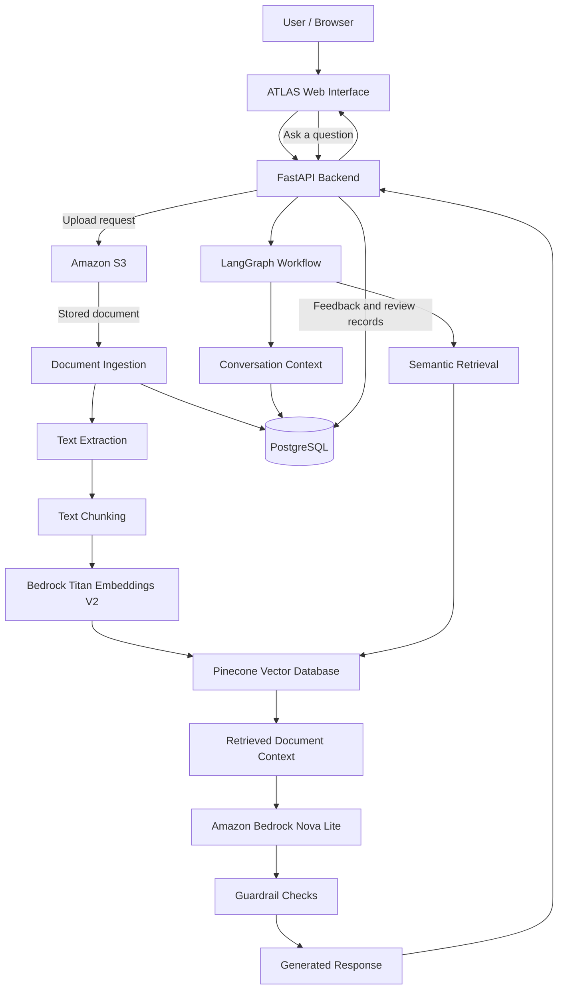
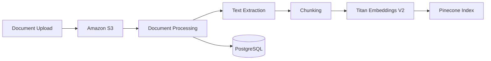
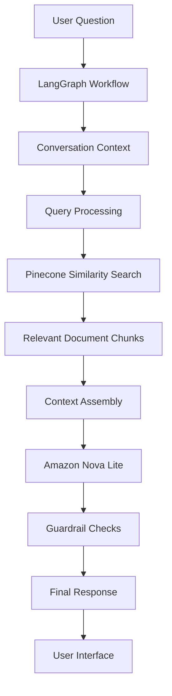
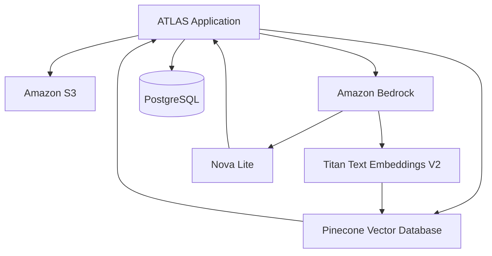

<div align="center">

# ATLAS — Enterprise AI Knowledge Workspace

### An AI-Powered Enterprise Knowledge Assistant Built with RAG, LangGraph, and Amazon Bedrock

**Document Intelligence · Semantic Search · Conversational Memory · Guardrails · AWS Integration**

[Overview](#overview) · [Architecture](#architecture) · [Features](#key-features) · [Quick Start](#getting-started) · [Technology Stack](#technology-stack) · [Security](#security-considerations)

</div>

---

## Project Demo

<div align="center">

### See ATLAS in Action


https://github.com/user-attachments/assets/5f139a1a-fec9-48d2-bc26-9f33d26bda24

*Watch the project walkthrough to see how ATLAS handles document uploads, knowledge retrieval, and AI-powered conversations.*

</div>

---

## Overview

**ATLAS (Enterprise AI Knowledge Workspace)** is an AI-powered knowledge assistant designed to make information stored in organizational documents easier to access and understand.

The idea behind ATLAS is simple: instead of manually searching through multiple documents, users should be able to ask questions in natural language and receive answers based on the information available in those documents.

I built ATLAS using Retrieval-Augmented Generation (RAG), combining document processing, semantic search, vector embeddings, and large language models into one application.

The system processes uploaded documents, extracts and splits their content into smaller chunks, generates embeddings, and stores them in a vector database. When a user asks a question, relevant information is retrieved and passed to the language model to generate a context-aware response.

The application also incorporates LangGraph-based workflow orchestration, conversation persistence, guardrails, and human-review functionality.

### What ATLAS brings together

- Document ingestion and processing
- Semantic search using vector embeddings
- Retrieval-Augmented Generation (RAG)
- LangGraph workflow orchestration
- Amazon Bedrock model integration
- Conversational context and persistence
- Input and output guardrails
- Human-in-the-loop review workflows
- AWS-based document storage and AI infrastructure

## Key Features

| Feature | Description |
|---|---|
| Document Ingestion | Upload and process organizational documents. |
| Amazon S3 Storage | Store original uploaded documents in AWS S3. |
| Text Processing | Extract document content and divide it into manageable chunks. |
| Embedding Generation | Generate semantic embeddings using Amazon Titan Text Embeddings V2. |
| Vector Search | Index and retrieve document chunks using Pinecone. |
| RAG Pipeline | Retrieve relevant document context before generating answers. |
| AI-Powered Responses | Generate natural-language responses using Amazon Nova Lite. |
| LangGraph Orchestration | Organize and manage the AI workflow. |
| Conversation Memory | Persist conversation data using PostgreSQL. |
| Guardrails | Apply input and output safety checks. |
| Human Review | Support review and approval workflows for selected requests. |
| Web Interface | Interact with the knowledge assistant through a browser-based workspace. |

## Technology Stack

| Layer | Technology | Purpose |
|---|---|---|
| Backend | Python, FastAPI, Uvicorn | Backend APIs and application server |
| Frontend | HTML, CSS, JavaScript | Browser-based interface |
| AI Orchestration | LangGraph | Stateful AI workflow management |
| LLM | Amazon Bedrock — Nova Lite | Response generation |
| Embeddings | Amazon Bedrock — Titan Text Embeddings V2 | Semantic embedding generation |
| Vector Database | Pinecone | Vector indexing and similarity search |
| Object Storage | Amazon S3 | Original document storage |
| Relational Database | PostgreSQL | Application data and conversation persistence |
| Cloud Infrastructure | Amazon Web Services | AI and storage infrastructure |

### Amazon Bedrock Models

ATLAS currently uses two models through Amazon Bedrock.

| Model | Model ID | Purpose |
|---|---|---|
| Amazon Nova Lite | `amazon.nova-lite-v1:0` | Language model for generating responses |
| Titan Text Embeddings V2 | `amazon.titan-embed-text-v2:0` | Generating document and query embeddings |

**AWS Region:** `ap-southeast-2`

---

## Architecture

ATLAS follows a modular architecture that separates document ingestion from question answering.

The application uses different services for storage, embedding generation, semantic retrieval, workflow orchestration, and response generation.

### 1. Application Architecture

The following diagram illustrates how the frontend, FastAPI backend, AWS services, vector database, and relational database interact.



### 2. Document Ingestion Pipeline

Document ingestion is responsible for transforming uploaded files into searchable vector representations.

The pipeline follows these stages:

1. Receive and validate the uploaded document.
2. Store the original document in Amazon S3.
3. Retrieve the document for processing.
4. Extract the available text.
5. Split the extracted content into smaller chunks.
6. Generate embeddings using Amazon Titan Text Embeddings V2.
7. Store the embeddings and associated metadata in Pinecone.
8. Maintain relevant document records in PostgreSQL.



**Current ingestion configuration:**

| Parameter | Value |
|---|---|
| Supported formats | PDF, DOCX, TXT, Markdown |
| Maximum upload size | 10 MB |
| Chunk size | 1,200 characters |
| Chunk overlap | 180 characters |
| Embedding model | Titan Text Embeddings V2 |
| Embedding dimensions | 1,024 |
| Vector database | Pinecone |

### 3. RAG Question-Answering Workflow

The question-answering pipeline retrieves relevant document information before sending context to the language model.



This approach helps reduce unsupported answers by providing the language model with relevant information retrieved from the uploaded documents.

### 4. AWS Infrastructure

ATLAS uses Amazon Web Services for document storage and model access.



The application integrates these services through its Python backend and configuration layer.

---

## Repository Structure

```text
ATLAS-Enterprise-AI/
│
├── app/
│   ├── static/
│   │   ├── css/
│   │   │   └── styles.css
│   │   └── js/
│   │       └── app.js
│   ├── templates/
│   │   └── index.html
│   ├── __init__.py
│   ├── aws.py
│   ├── config.py
│   ├── db.py
│   ├── demo_context.py
│   ├── graph.py
│   ├── guardrails.py
│   ├── main.py
│   ├── memory.py
│   ├── observability.py
│   ├── rag.py
│   └── vector.py
│
├── infra/
│   └── schema.sql
├── scripts/
│   └── init_db.py
├── worker/
│   ├── __init__.py
│   └── ingest.py
│
├── .env.example
├── .gitignore
├── create_structure.py
├── LICENSE
├── requirements.txt
└── README.md
```

### Core Application Modules

| Module | Responsibility |
|---|---|
| `main.py` | FastAPI application and API routes |
| `config.py` | Environment configuration and application settings |
| `aws.py` | AWS service clients and integrations |
| `graph.py` | LangGraph workflow orchestration |
| `rag.py` | Retrieval-Augmented Generation integration |
| `vector.py` | Pinecone vector database operations |
| `db.py` | PostgreSQL database operations |
| `memory.py` | Conversation persistence utilities |
| `guardrails.py` | Input and output safety checks |
| `observability.py` | Observability configuration |
| `worker/ingest.py` | Document ingestion and indexing |
| `templates/` | HTML templates |
| `static/` | CSS and JavaScript assets |

---

## Getting Started

Follow the steps below to run ATLAS locally.

### Prerequisites

Make sure the following are available:

- Python 3.12
- Git
- AWS account with Amazon Bedrock access
- Amazon S3 bucket
- Pinecone account and API key
- PostgreSQL database

### 1. Clone the Repository

```bash
git clone https://github.com/LakshyaPandey3/ATLAS-Enterprise-AI.git

cd ATLAS-Enterprise-AI
```

### 2. Create a Virtual Environment

**Windows PowerShell**

```powershell
python -m venv atlas

.\atlas\Scripts\Activate.ps1
```

**Linux / macOS**

```bash
python -m venv atlas

source atlas/bin/activate
```

### 3. Install Dependencies

```bash
python -m pip install --upgrade pip

pip install -r requirements.txt
```

### 4. Configure Environment Variables

Create a `.env` file from the provided example.

**Windows PowerShell**

```powershell
Copy-Item .env.example .env
```

Configure your AWS, Pinecone, and PostgreSQL credentials.

The main configuration areas include:

| Configuration | Description |
|---|---|
| AWS credentials | AWS service authentication |
| AWS region | AWS deployment region |
| S3 bucket | Document storage |
| Bedrock models | Chat and embedding model configuration |
| Pinecone API key | Vector database authentication |
| Pinecone index | Vector index configuration |
| Database URL | PostgreSQL connection |
| Memory configuration | Conversation history settings |
| Guardrail configuration | Workflow safety settings |

Refer to `.env.example` and `app/config.py` for the exact supported variable names.

**Important:** Never commit `.env` files, AWS credentials, database passwords, or API keys to GitHub.

For AWS environments, prefer IAM roles and secure credential providers instead of hardcoding access keys.

### 5. Run the Application

From the project root:

```bash
python -m uvicorn app.main:app --reload --host 127.0.0.1 --port 8000
```

Open the application:

```text
http://127.0.0.1:8000
```

---

## API Reference

The FastAPI backend exposes endpoints for application functionality.

The following table lists the implemented API endpoints, their HTTP methods, and their purposes.

| Method | Endpoint | Purpose |
|---|---|---|
| GET | `/` | Serve the web application |
| GET | `/health/live` | Check whether the application process is running |
| GET | `/health/ready` | Check application readiness |
| POST | `/api/documents/uploads` | Initiate a document upload |
| POST | `/api/documents/complete` | Complete and process a document upload |
| GET | `/api/documents` | List uploaded documents |
| POST | `/api/chat` | Submit a question to the RAG workflow |
| GET | `/api/conversations/{conversation_id}/messages` | Retrieve conversation messages |
| POST | `/api/feedback` | Record response feedback |
| GET | `/api/admin/metrics` | Retrieve application metrics |
| GET | `/api/approvals` | List pending review decisions |
| POST | `/api/approvals/{approval_id}/decision` | Record an approval or rejection decision |
| GET | `/api/admin/guardrails` | Retrieve guardrail information |

FastAPI's interactive documentation can be accessed at:

```text
http://127.0.0.1:8000/docs
```

*This URL is available when the FastAPI documentation endpoints are enabled.*

---

## Guardrails and Human-in-the-Loop

ATLAS incorporates safety checks into its AI workflow.

The guardrail layer is designed to handle potentially unsafe inputs and outputs, including attempts to expose sensitive information or override application instructions.

The human-review functionality supports recording decisions for selected requests that require additional review.

These capabilities are intended to provide additional control around AI interactions.

**Note:** The current demonstration identity context is not a production authentication system. Human-review decisions are not equivalent to automated authorization or execution of destructive operations.

---

## Testing and Validation

The application is developed with a focus on validating individual components and their integration.

Development checks include:

- Python compilation checks.
- Module import validation.
- Workflow initialization checks.
- Application startup checks.
- RAG workflow smoke testing.
- Input and output guardrail checks.
- Git patch validation.

Example commands:

```bash
python -m compileall -q app worker
```

```bash
git diff --check
```

A comprehensive automated unit and integration test suite remains an area for further improvement.

---

## Security Considerations

ATLAS is an educational and development-oriented implementation of an enterprise AI knowledge assistant.

Before using it in a real enterprise environment, additional security measures are necessary.

Important areas include:

- Implementing authentication and role-based authorization.
- Introducing tenant isolation and document-level access controls.
- Restricting AWS IAM permissions.
- Protecting API keys and application secrets.
- Enforcing HTTPS and request rate limiting.
- Validating uploaded documents and file contents.
- Protecting conversation history and sensitive document information.
- Adding comprehensive automated tests.
- Implementing deployment health checks and rollback mechanisms.
- Establishing data retention and backup policies.

Retrieved document content should also be treated as untrusted input, with appropriate prompt-injection protections.

---

## Challenges and Engineering Considerations

A few important areas of consideration while developing ATLAS:

**Document Chunking**

The size and overlap of document chunks influence how much relevant context can be retrieved for a question.

**Embedding Compatibility**

The embedding dimensions configured in the model and vector database must match. ATLAS uses 1,024-dimensional embeddings.

**Retrieval Quality**

Semantic similarity alone does not guarantee that the retrieved content answers the user's question. Retrieval quality and context selection are important parts of RAG engineering.

**LLM Reliability**

Language models can generate unsupported information. Providing relevant document context and applying guardrails helps improve response reliability.

**Cloud Integration**

Integrating multiple managed services requires careful handling of authentication, configuration, network access, and service availability.

---

## Future Improvements

Some areas I would like to explore further:

- Production-grade authentication and authorization.
- Multi-tenant document management.
- Improved retrieval quality and evaluation.
- OCR support for scanned documents.
- Asynchronous document ingestion.
- More comprehensive automated testing.
- Advanced observability and monitoring.
- Deployment health checks and automated rollback.
- Document-level access permissions.
- Improved conversation management.

---

## What I Learned

Building ATLAS has given me practical experience with the engineering involved in developing an AI application beyond a simple LLM integration.

Some of the areas I have worked with include:

- Designing a Retrieval-Augmented Generation pipeline.
- Processing documents for semantic search.
- Working with embedding models and vector databases.
- Integrating Amazon Bedrock models.
- Orchestrating AI workflows using LangGraph.
- Managing application data with PostgreSQL.
- Integrating AWS storage services.
- Implementing guardrails and review workflows.
- Structuring a modular FastAPI application.
- Working with AWS cloud infrastructure.

One of the biggest takeaways has been understanding how document processing, retrieval, orchestration, databases, and language models work together to create a complete AI-powered application.

---

## Contributing

Suggestions, feedback, and improvements are welcome.

If you would like to contribute:

1. Fork the repository.
2. Create a feature branch.
3. Implement your changes.
4. Validate your implementation.
5. Submit a pull request with a description of the changes.

Please avoid committing credentials, private documents, or sensitive configuration files.

---

## License

ATLAS is licensed under the [MIT License](LICENSE).

---

<div align="center">

### ATLAS — Enterprise AI Knowledge Workspace

**Turning organizational documents into searchable, context-aware knowledge.**

Designed and developed by **[Lakshya Pandey](https://github.com/LakshyaPandey3)**

[GitHub](https://github.com/LakshyaPandey3)

</div>
